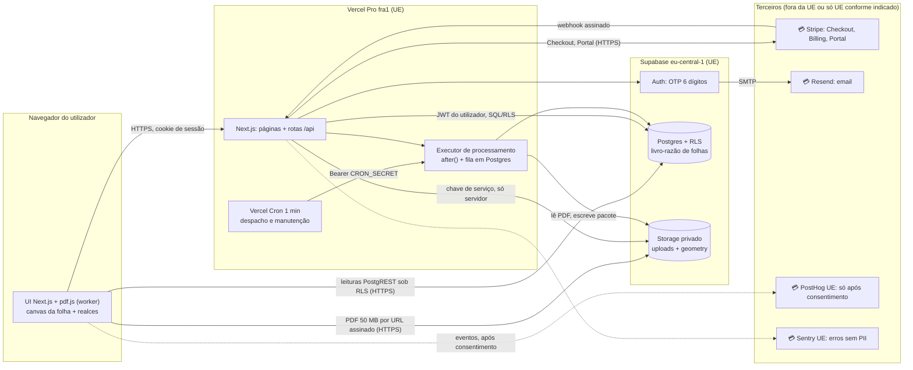
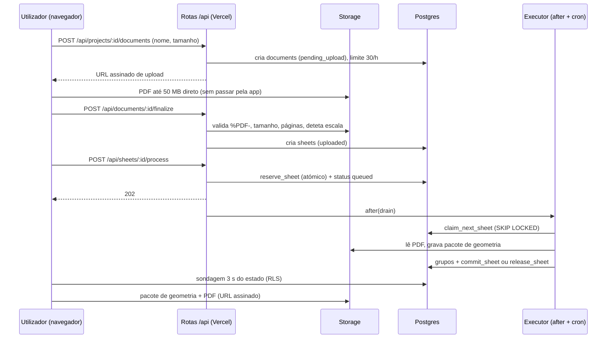
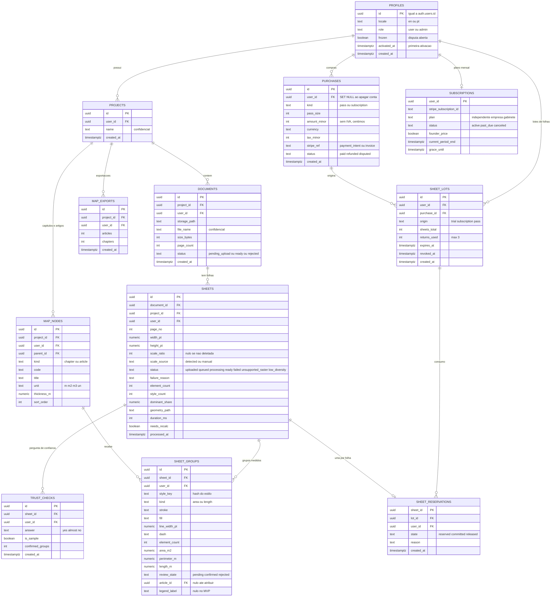

# Arquitetura — Rastoplan

> **Produto:** `civil-pt` · **Versão:** 0.1 · **Data:** 2026-11-28 · **Profundidade:** standard · **Receita (`stack.recipe`):** `web-saas` (camada de IA da receita `ai-app` **dormente**, ADR 0008) · **Depende de:** `02-product.md` (v0.2), `02-business.md` (v0.2) · **ADRs:** `docs/adr/`
>
> Todas as versões, preços e limites foram verificados a **2026-11-28** (`npm view` e páginas oficiais, URL na tabela de cada secção). São «verificar à data de execução»: a construção volta a verificar o que usar. **Nome:** Rastoplan (decidido pela fase `brand`, que correu em paralelo: `docs/03-brand.md`; «Medições PT» era o nome de trabalho dos PRD e da estratégia, que continuam a usá-lo) · domínio escolhido `rastoplan.com` (a compra é a tarefa de fundador da marca).

## 1. Resumo e decisões-chave

- **Stack:** Next.js 16 (starter da fábrica) em **Vercel Pro, região `fra1`** + **Supabase Pro, região `eu-central-1` (Frankfurt)** para autenticação (código de 6 dígitos + página de confirmação), Postgres com RLS e armazenamento privado + **Stripe direto** (Checkout, Billing, Customer Portal; IVA configurável) + Resend + PostHog UE + Sentry UE. O motor de medição é **`pdfjs-dist` (Apache-2.0) a correr em Node, no servidor, fora do pedido do utilizador** (`after()` + fila em Postgres + *cron* de despacho); o mesmo `pdfjs-dist` desenha a folha no navegador. **Não há IA no MVP.**
- **Porquê:** é a receita `web-saas` da fábrica com o mínimo de desvios; o produto **entrega geometria exata, não inferência** (PRD §7), por isso a camada `ai-app` fica de fora até US-07 ter gatilho (ADR 0001, 0008). Uma só linguagem (TypeScript), um só motor de PDF para servidor e navegador, nada de contentores nem filas externas.
- **Custo mensal (secção 10):** **€42,00 a 0** · **€42,00 a 100 contas ativas** (dentro dos créditos incluídos) · **≈ €1 241 a 10 000** (teórico: o universo nomeável é ≈ 5 600 contas e o fundador só serve ≈ 6 a 5 h/semana, `02-business.md` §6). Taxas de pagamento à parte (3,6 % da receita). Antes do go-live: **€0** (pré-visualizações em Vercel Hobby e Supabase gratuito de desenvolvimento).
- **Principais riscos técnicos:** (1) **fidelidade em plantas reais**: o gate G-GEO ficou **inconclusivo** (não foi possível obter folhas de desenho reais a partir de um ambiente sem acesso às plataformas de contratação; secção 16 e ADR 0006), por isso o agrupamento por estilo segue com risco aceite e medido (T4, T4b); (2) **motor de PDF em *serverless* + visualizador** (`pdfjs-dist` 6 mudou o formato interno das operações; processamento assíncrono em funções com limite de 300 s; realce de dezenas de milhares de elementos em ≤ 300 ms); (3) **correção do livro-razão de folhas** (reservas atómicas, webhooks repetidos, reembolsos, disputas) e a **dupla configuração fiscal F1/F2**.
- **Precisa do fundador (contas/chaves):** tarefas B (estatuto fiscal), A (Stripe), D (despesa fixa de produção, €41/mês) já propostas em `02-business.md` §13; a arquitetura acrescenta E a J (secção 16.5). **Até lá a app corre inteira em modo de teste** (adaptadores `memory`/`mock`/`console`).
- **Desvios à receita:** (a) `web-saas` em vez de `ai-app` apesar de `type: ai-app` (**ADR 0001**); (b) motor de PDF e processamento assíncrono, que nenhuma receita cobre (**ADR 0005**); (c) agrupamento ainda não validado em dados reais (**ADR 0006**). Restantes ADRs seguem os defaults (0002, 0003, 0004, 0007, 0008).

## 2. Condicionantes (drivers)

| Driver | Valor | Fonte (história/secção) |
|---|---|---|
| Tipo e plataformas | Aplicação web (navegador de secretária; sem aplicação móvel). `product.json` `type: ai-app`; receita escolhida `web-saas` | `product.json`; PRD §5.5 (Won't: móvel) |
| Idiomas e mercados | UI `en` + `pt-PT`; conteúdo longo só pt-PT; Portugal; EUR; unidades pt-PT | PRD §7 (Idiomas) |
| Contas e papéis | 1 utilizador por conta (sem equipas); papéis `user` e `admin` (admin só por *scripts* de serviço, sem UI) | PRD §5.5; US-01 |
| Dados pessoais | Email; hash de IP (24 h); NIF-IVA/morada de faturação só no Stripe; **conteúdo do cliente** (PDF de concursos, confidencial; pode conter dados pessoais incidentais). Sem categorias especiais nem menores | PRD §7 Privacidade; secção 14 |
| Dinheiro | Stripe direto, vendedor = fundador, só B2B; Passes (pagamento único, 90 dias) e subscrições (lotes mensais de 90 dias); IVA em dois regimes configuráveis (F1 isento, F2 normal) | `02-business.md` §3, §4; US-08, US-12 |
| IA | **Nenhuma no MVP.** US-07 é Should 5.º com gatilho; se existir, só texto da legenda (não o PDF) | PRD §5.4, §7; ADR 0008 |
| Escala a 12 meses | ≈ 6 contas ativas (teto de horas do fundador) a ≈ 71 contas criadas; 17 folhas/conta ativa/mês; PDF ≤ 50 MB e ≤ 40 páginas; ≤ 50 000 elementos por folha (carga de teste) | `02-business.md` §8; US-02; US-04 (3) |
| Disponibilidade e latência | 99,0 % mensal sem SLA; LCP ≤ 2,5 s; folha: p50 ≤ 30 s, p95 ≤ 90 s; abrir folha já processada ≤ 3 s; realce ≤ 300 ms | PRD §7 |
| Orçamento | ≤ €50/mês antes de receita (previsto €42); custo variável infra+IA ≤ 30 % do ARPU (IA ≤ 25 %) | `FOUNDER.md`; `02-business.md` §7 |
| Sinalizadores de conformidade | Sem saúde, finanças pessoais, menores ou biometria. **Dois pontos para o `legal`:** (i) peças confidenciais de terceiros; (ii) faturas com retenção fiscal vs. pedido de apagamento | PRD §7; secção 14 |

## 3. Stack escolhida

Receita: `factory/stacks/web-saas.md` (+ `ai-app.md` dormente, ADR 0008) · Componentes: nenhum extra (um só *deployable*) · `app_dir`: `app`

| Preocupação | Escolha | Versão verificada (`npm view`, 2026-11-28) | Porquê | Limites do plano gratuito / pago (fonte, 2026-11-28) |
|---|---|---|---|---|
| Framework | Next.js 16 App Router, React 19, Tailwind 4, TypeScript 7 (starter da fábrica) | next 16.4.6 · react 19.3.1 · typescript 7.0.2 · vitest 5.1.2 · @playwright/test 1.65.1 | Legal, SEO, consentimento e i18n já resolvidos pela starter (PRD §5: não contados) | — |
| Alojamento | **Vercel Pro**, funções em `fra1` (Frankfurt, `eu-central-1`) | — | Funções Node com 2 GB (máx. 4 GB), 300 s por defeito (máx. 800 s), `after()` suportado; Hobby é não comercial (regra da fábrica) | Pro $20/mês, crédito de uso incluído; corpo de pedido ≤ 4,5 MB; pacote ≤ 250 MB ([limites](https://vercel.com/docs/functions/limitations), [preços](https://vercel.com/pricing), [regiões](https://vercel.com/docs/regions)) |
| Base de dados | **Supabase Postgres** `eu-central-1`, RLS obrigatório; leituras do navegador por PostgREST sob RLS; escritas de estado por rotas do servidor | @supabase/supabase-js 2.119.2 · @supabase/ssr 0.12.7 · supabase (CLI) 3.4.0 | Mesmo modelo de autenticação e políticas; sem servidor próprio | Gratuito: 500 MB, pausa após 1 semana, 2 projetos. **Pro $25/mês**: 8 GB, 7 dias de cópias diárias, **sem PITR** (+$100/mês) ([preços](https://supabase.com/pricing)) |
| Armazenamento | **Supabase Storage**, *buckets* privados `uploads` e `geometry`, URL assinado de upload e de descarga | (idem) | Mesma autenticação; limite de 50 MB por ficheiro cobre o PDF máximo do PRD | Gratuito 1 GB, 50 MB por ficheiro; Pro 100 GB incluídos, $0,0213/GB extra, egress 250 GB + $0,09/GB |
| Autenticação | **Supabase Auth**: código OTP de 6 dígitos **e** ligação com página de confirmação (POST), passwordless | (idem) | US-01; integra com RLS; 50 000 MAU gratuitos; ver ADR 0003 | MAU 50 000 (gratuito), 100 000 (Pro); OTP: 1 pedido/60 s por utilizador; validade configurável (defeito 1 h → 10 min) ([docs](https://supabase.com/docs/guides/auth/auth-email-passwordless)) |
| Motor de PDF | **`pdfjs-dist` (Apache-2.0), versão fixa** `6.5.438`; servidor em Node ≥ 22.13 **sem** `@napi-rs/canvas`; navegador com *worker* | pdfjs-dist 6.5.438 (publicado 2026-11-01); engines `node >=22.13.0 \|\| >=24` | Um só motor para extrair (servidor) e desenhar (navegador); licença permissiva (PyMuPDF/AGPL excluído, PRD §10); ADR 0005 | — |
| Excel | **`write-excel-file`** (MIT) | 4.1.1 (alterado 2026-06-08) | `exceljs` 4.4.0 sem versão desde 2024-12-20 (> 11 meses): fora da regra «release < 12 meses»; spike S4 gerou um `.xlsx` de 2 folhas válido | — |
| Pagamentos | **Stripe direto**: Checkout (pagamento único e subscrição), Billing, Customer Portal; Stripe Tax só em F2 | stripe 23.2.0 | Decisão da estratégia (B2B, sem MoR); ADR 0004 | EEE padrão 1,5 % + €0,25; Billing 0,7 %; Tax 0,5 % (Checkout sem código) ou €0,45 (API); disputa €20 ([Stripe PT](https://stripe.com/en-pt/pricing)) |
| Email | **Resend** (códigos de acesso, avisos) + SMTP do Supabase Auth apontado ao Resend | resend 6.41.0 | Recipe; o SMTP integrado do Supabase é limitado e sem marca | Gratuito 3 000/mês e **100/dia**, 3 domínios; Pro $20 (50 000) ([Resend](https://resend.com/pricing)) |
| Analítica | **PostHog UE** (`eu.posthog.com`), só após consentimento; métricas de negócio vêm da BD | posthog-js 1.455.4 · posthog-node 6.2.0 | Gratuito até 1 M eventos/mês; Plausible custa $9/mês e consome a folga de €8 do teto (ADR 0007) | 1 M eventos, 5 000 gravações, 1 M pedidos de *flags* ([PostHog](https://posthog.com/pricing), via pesquisa 2026-11-28; a página trunca) |
| Erros | **Sentry** (`@sentry/nextjs`), residência de dados UE | @sentry/nextjs 11.20.0 | Recipe; sem PII em eventos | Developer: 5 000 erros/mês, 1 utilizador; Team $29/mês ([Sentry](https://sentry.io/pricing/)) |
| Limite de pedidos | **Contadores em Postgres** (função `rl_hit`), sem Upstash | — | Menos um serviço e um subcontratante (máx. 8 no MVP); a receita admite esta alternativa | — |
| IA (dormente) | `@anthropic-ai/sdk` só se US-07 for construída | 1.14.0 (a receita `ai-app` cita 0.132: desatualizada) | ADR 0008 | Sonnet 5.5 $2/$10 por MTok; Haiku 5.5 $0,10/$0,50 ([Anthropic](https://platform.claude.com/docs/en/about-claude/pricing)) |

**Desvios à receita**

| O quê | Por omissão da receita | Opções pontuadas (1–5: cumpre a história · custo a 10k · tempo de construção · lock-in · residência UE · manutenção) | ADR |
|---|---|---|---|
| Receita `web-saas` com `type: ai-app` | `ai-app` = `web-saas` + camada Anthropic (guarda, livro-razão de IA, quotas) | A `ai-app`: 3·3·2·3·3·4 = **18** · B `web-saas` + camada dormente: 5·5·5·4·5·4 = **28** · C `web-saas` com Better Auth + Drizzle + Neon: 4·4·2·5·4·3 = **22** → B | 0001 |
| Motor de PDF no servidor, assíncrono, com pacote de geometria | Nenhuma receita cobre processamento pesado | A `pdfjs-dist` em função Node: 5·4·5·4·5·4 = **27** · B `pdfminer.six` em função Python: 4·3·3·3·5·3 = **21** · C PyMuPDF (AGPL): excluído por licença · D contentor Fly.io/Railway: 5·3·2·3·4·3 = **20** → A | 0005 |
| Excel com `write-excel-file` | (receita omissa) | `exceljs` não mantido; ver tabela acima | (sem ADR: dependência) |

## 4. Diagrama

Fronteiras de confiança: navegador ↔ Vercel; Vercel ↔ Supabase (chave de serviço só no servidor); Stripe ↔ webhook (assinatura); Cron ↔ rotas internas (segredo). Os 💳 são serviços com conta do fundador; todos têm substituto de teste (secção 8).

## 5. Modelo de dados

### 5.1 Diagrama ER

Tabelas **sem relações no diagrama** (só serviço): `stripe_events(id text PK, type, received_at)` (idempotência), `rate_limits(key, window_start, count)`, `auth_attempts(email_hash PK, failed, locked_until)`, `signup_ip_daily(ip_hash, day, count)`, `trial_grants(email_hash PK, user_id, created_at)`, `billing_customers(user_id PK, stripe_customer_id unique)`, `audit_log(id, actor, action, target, created_at)`.

### 5.2 Entidades

| Entidade | Atributos-chave | PII? | Dono (coluna) | Índices | História |
|---|---|---|---|---|---|
| `profiles` | `locale`, `role`, `frozen`, `activated_at` | Indireto (liga ao email em `auth.users`) | `id = auth.uid()` | PK | US-01, US-08 (12) |
| `projects` | `name` | **Confidencial** (nome de obra/cliente) | `user_id` | `(user_id, created_at desc)` | US-02 |
| `documents` | `storage_path`, `file_name`, `size_bytes`, `page_count`, `status` | Confidencial | `user_id` | `(project_id)`, `(status, created_at)` parcial `pending_upload` | US-02 |
| `sheets` | `page_no`, `scale_ratio`, `status`, `element_count`, `dominant_share`, `geometry_path` | Não | `user_id` | `(document_id, page_no)` único; `(status, created_at)` para a fila; `(user_id, status)` | US-03, US-04, US-05 |
| `sheet_groups` | `style_key`, `kind`, `area_m2`, `perimeter_m`, `length_m`, `review_state`, `article_id` | Não | `user_id` | `(sheet_id)`; `(article_id)` | US-04, US-05, US-06 |
| `map_nodes` | `kind`, `code`, `title`, `unit`, `thickness_m`, `parent_id` | Confidencial | `user_id` | `(project_id, parent_id, sort_order)` | US-06 |
| `map_exports` | `articles`, `chapters` | Não | `user_id` | `(user_id, created_at desc)` (métrica norte) | US-06 |
| `trust_checks` | `answer`, `is_sample`, `confirmed_groups` | Não | `user_id` | `(user_id, created_at)` | US-05 (3, 4) |
| `purchases` | `kind`, `pass_size`, `amount_minor`, `tax_minor`, `stripe_ref`, `status` | Mínimo (sem NIF; **retenção fiscal**) | `user_id` (`ON DELETE SET NULL`) | `stripe_ref` único | US-08, US-12 |
| `sheet_lots` | `origin`, `sheets_total`, `expires_at`, `revoked_at`, `returns_used` | Não | `user_id` | `(user_id, expires_at)` | US-08, US-12 |
| `sheet_reservations` | `state`, `lot_id`, `reason` | Não | `user_id` | PK `sheet_id`; `(lot_id, state)` | US-04, US-05 (7), US-08 |
| `subscriptions` | `plan`, `status`, `founder_price`, `grace_until` | Não | `user_id` | `stripe_subscription_id` único | US-08 |

Convenções: UUID, `created_at`/`updated_at timestamptz` UTC, dinheiro em unidades menores + moeda (EUR), enumerações como texto + `CHECK`, **apagar de verdade** (sem *soft delete*), quantidades em `numeric` (nunca `float`). O livro-razão **não** guarda saldo: o saldo é `sum(sheets_total) − count(reservas reserved|committed)` dos lotes não expirados e não revogados (vista com `security_invoker`).

### 5.3 Regras de acesso (RLS / autorização)

Todas as tabelas de `public` têm `enable row level security`; políticas `to authenticated` com `(select auth.uid()) = user_id`; **nenhuma** política em `anon`. Colunas sensíveis protegidas por *grants* por coluna (`revoke update … grant update (colunas) …`).

| Tabela | select | insert | update | delete | Justificação |
|---|---|---|---|---|---|
| `profiles` | dono | trigger em `auth.users` (definer) | dono, só `locale` (grant por coluna) | — (cascata de `auth.users`) | `role` e `frozen` só pelo servidor |
| `projects` | dono | dono | dono | dono (o servidor remove também os ficheiros: ver 5.4) | US-02 |
| `documents` | dono | só servidor | só servidor | só servidor | máquina de estados e caminho decididos pelo servidor |
| `sheets` | dono | só servidor | só servidor | só servidor | idem; evita forjar `status` ou `element_count` |
| `sheet_groups` | dono | só servidor | dono, só `review_state` e `article_id` (grant por coluna; *trigger* garante que o artigo é do mesmo projeto) | só servidor | US-05/US-06; a quantidade nunca é editável |
| `map_nodes` | dono | dono | dono | dono | US-06 |
| `map_exports`, `trust_checks` | dono | só servidor | — | — | métrica norte e ativação calculadas no servidor |
| `purchases`, `subscriptions`, `billing_customers` | dono | só servidor (webhook) | só servidor | — | estado de pagamento nunca é do cliente |
| `sheet_lots`, `sheet_reservations` | dono | **só funções** `SECURITY DEFINER` (execução revogada a `anon`/`authenticated`) | idem | — | ver 5.4; impede saldo forjado |
| `stripe_events`, `rate_limits`, `auth_attempts`, `signup_ip_daily`, `trial_grants`, `audit_log` | — (RLS ligado, **sem políticas**) | só servidor | só servidor | só servidor | internas; chave de serviço |
| `storage.objects` `uploads` | dono (`foldername[1] = auth.uid()`) | só via URL assinado emitido pelo servidor | — | só servidor | PDF privado; `file_size_limit` 50 MB, `allowed_mime_types = application/pdf` |
| `storage.objects` `geometry` | dono | só servidor | só servidor | só servidor | pacote gerado pelo executor |

Vistas com `security_invoker = true`; funções com `set search_path = ''`. Chave de serviço **só** em código de servidor (`import 'server-only'`) e nunca em `NEXT_PUBLIC_*`.

### 5.4 Funções SQL, migrações, apagar e exportar

- **Funções (`SECURITY DEFINER`, testadas com relógio injetável `p_now`):** `reserve_sheet(sheet)` (escolhe o lote que expira primeiro, empate o mais antigo, com bloqueio de linha; idempotente por folha; falha com `no_balance`), `commit_sheet(sheet)`, `release_sheet(sheet, reason)` (`failed`, `raster`, `low_diversity`, `returned`; devolução máx. 3 por lote), `claim_next_sheet(n)` (`FOR UPDATE SKIP LOCKED`), `grant_lot(user, origin, n, expires_at, purchase)`, `revoke_lot(lot)` (revoga só as não usadas; saldo nunca negativo), `rl_hit(key, limit, window)`, `try_founder_price()` (atómica, ≤ 10), gatilho `trial_grant_for_new_user()` (5 folhas, 14 dias, 1 por email normalizado).
- **Migrações:** SQL com data em `supabase/migrations/` (expandir → *deploy* → contrair; migrações antes da app) · **Seed:** `supabase/seed.sql` e fixtures de memória partilhadas (5 utilizadores, 3 projetos, folhas sintéticas) · **Testes de RLS:** `supabase/tests/` (utilizador A não lê nem escreve dados de B; `anon` não vê nada; cada tabela).
- **Apagar projeto (US-02 crit. 5):** rota do servidor valida o dono, remove primeiro os objetos de Storage (prefixo `{user}/{project}/`), depois as linhas (cascata). Se o Storage falhar, as linhas ficam e o utilizador vê erro (sem órfãos silenciosos). A manutenção semanal lista objetos sem linha e remove-os.
- **Exportar/apagar conta (RGPD):** US-15 é Should 4.º (antes de 20 contas). Até lá: *runbook* manual (`scripts/erase-user.ts`, só serviço): apaga `auth.users` (cascata em tudo), objetos de Storage e cliente Stripe; `purchases` ficam com `user_id = NULL` pela retenção fiscal. Prazo legal ≤ 30 dias (PRD §7).

## 6. Superfície de API

Convenções: erros `application/problem+json` (RFC 9457); validação **zod** em cada fronteira (entrada, ambiente, webhook, saída de IA); sem `/v1` (API não pública); leituras de listas/estado pelo navegador por PostgREST sob RLS (menos superfície); **escritas que mudam estado só por rotas do servidor**. Limites de pedidos por `rl_hit` (chave = utilizador, ou hash de IP + email).

| Método + caminho / ação | Finalidade | História | Auth | Entrada (zod) | Saída | Limite | Idempotência |
|---|---|---|---|---|---|---|---|
| `POST /api/auth/otp` | Enviar código + ligação | US-01 | anónimo | `OtpRequestSchema {email, locale, next?}` | 202 sem revelar se o email existe | 5/h por email e por IP; 3 contas novas/IP/dia | sim (reenvio ≥ 60 s) |
| `POST /api/auth/verify` | Validar o código de 6 dígitos | US-01 (2,5,6) | anónimo | `VerifyCodeSchema {email, code}` | sessão (cookies) ou erro | 5 falhas → bloqueio 15 min e **rotação do código** | — |
| `GET /auth/confirm` (página) + `POST /api/auth/confirm` | Página «Confirmar entrada»; só o POST do botão consome o `token_hash` | US-01 (1,3) | anónimo | `ConfirmSchema {token_hash, type}` | sessão | 30/5 min por IP | — |
| `POST /api/auth/signout` | Terminar sessão | US-01 | utilizador | — | 204 | — | sim |
| `POST /api/projects`, `DELETE /api/projects/:id` | Criar / apagar projeto (apagar remove ficheiros) | US-02 | utilizador | `CreateProjectSchema {name ≤ 120}` | 201 / 204 | 60/h | `Idempotency-Key` no POST |
| `POST /api/projects/:id/documents` | Registar PDF e obter URL assinado de upload | US-02 | utilizador | `NewDocumentSchema {fileName, sizeBytes ≤ 50 MB}` | `{documentId, uploadUrl, token}` | **30 carregamentos/h** | por `documentId` |
| `POST /api/documents/:id/finalize` | Validar `%PDF-`, tamanho, ≤ 40 páginas; criar folhas; detetar escala | US-02 (1–4), US-03 | utilizador | `{}` | folhas | 30/h | sim (já finalizado → mesmas folhas) |
| `GET /api/documents/:id/url` | URL assinado de descarga (≤ 600 s) para o pdf.js | US-02 (1), US-05 | utilizador | — | `{url, expiresAt}` | 120/h | — |
| `PUT /api/sheets/:id/scale` | Definir escala (1:1 a 1:10000); marca quantidades «a recalcular» | US-03 | utilizador | `ScaleSchema {ratio}` | 200 | 60/h | sim |
| `POST /api/sheets/:id/process` | Reservar folha, pôr em fila, arrancar executor | US-04, US-08 | utilizador | `{}` | 202 `{status:"queued"}`; 200 se já `ready` (sem nova cobrança); 402 `no_balance` | 60/h; ≤ 3 em simultâneo por utilizador | **sim** (por folha) |
| `POST /api/sheets/:id/trust` | Registar resposta à pergunta de confiança; calcula `activation_reached` | US-05 (3,4) | utilizador | `TrustSchema {answer}` | 204 | 20/h | 1 ativação por conta |
| `POST /api/sheets/:id/return-credit` | Devolver a folha se nenhum grupo foi confirmado | US-05 (7) | utilizador | `{}` | 200 / 409 | 10/h | sim |
| `POST /api/projects/:id/export` | Gerar `.xlsx` («Mapa de Quantidades» + «Rasto»), ≤ 10 s | US-06 | utilizador | `{}` | ficheiro | 20/h | — |
| `POST /api/checkout` | Criar sessão Stripe Checkout (Passe ou subscrição) | US-08, US-12 | utilizador (anónimo → `/entrar?next=`) | `CheckoutSchema {kind, plan?, passSize?, locale}` | `{url}` | 20/h | `Idempotency-Key` |
| `POST /api/billing/portal` | Abrir o Customer Portal | US-08 (13) | utilizador | `{}` | `{url}` | 20/h | — |
| `POST /api/webhooks/stripe` | Webhook assinado | US-08, US-12 | assinatura `Stripe-Signature` sobre o corpo cru | evento tipado (zod por tipo) | 200 | — | por `event.id` (`stripe_events`) |
| `GET /api/health` | Saúde (ping à BD) | NFR | anónimo | — | 200/503 | 60/min por IP | — |
| `POST /api/internal/process-queue` | Executor da fila | US-04 | segredo `CRON_SECRET` | — | 200 | — | `SKIP LOCKED` |
| `GET /api/cron/maintenance` | Manutenção (ver 12) | US-02 (4), US-04 | `Authorization: Bearer $CRON_SECRET` | — | 200 | — | idempotente |
| `POST /api/waitlist` | Pedir demonstração (starter) | `demo_requested` | anónimo | schema da starter | 202 | da starter | da starter |
| *(Should)* `POST /api/account/export`, `POST /api/account/delete` | Exportar e apagar conta | US-15 | utilizador | `{confirmEmail}` | JSON / 202 | 3/dia | sim |

**Webhooks recebidos do Stripe** (assinatura verificada com `STRIPE_WEBHOOK_SECRET`, tolerância de relógio de 300 s, idempotência por `event.id`): `checkout.session.completed` (cria lote do Passe), `customer.subscription.created|updated|deleted`, `invoice.paid` (cria o lote do período, 90 dias), `invoice.payment_failed` (graça 7 dias), `charge.refunded` (revoga folhas por usar), `charge.dispute.created|closed` (congela/descongela). Webhooks de saída: nenhum.

## 7. Autenticação e autorização

- **Fornecedor e fluxos:** Supabase Auth, e-mail sem palavra-passe. O modelo de email contém o **código de 6 dígitos** (variável `.Token` do modelo do Supabase) **e** uma ligação para `/<idioma>/auth/confirm?token_hash=…&type=email` (variável `.TokenHash`) que só mostra o botão «Entrar»; o *token* é consumido **apenas** no POST do botão (um *scanner* que faz GET não o consome; US-01 crit. 3). Validade do código **600 s** (`otp_expiry`). PKCE com `@supabase/ssr`.
- **Sessão:** cookies geridos por `@supabase/ssr`; o servidor decide acesso com `supabase.auth.getUser()` (nunca `getSession()` para autorização); *proxy* protege `(app)` e cada rota repete a verificação. Redirecionamentos pós-login só para caminhos relativos do próprio site (lista de permitidos; sem *open redirect*).
- **Limitação de tentativas (US-01 crit. 6):** `POST /api/auth/verify` conta falhas por email normalizado em `auth_attempts`; à 5.ª falha bloqueia 15 min e **roda o código ativo** (pedido interno de `auth.admin.generateLink` sem envio), para o código anterior deixar de ser válido. Spike S7 confirma antes de construir. A limitação nativa do Supabase (1 pedido/60 s por utilizador) fica como segunda camada.
- **MFA:** não no MVP (utilizadores B2B, sem dados pessoais sensíveis); disponível para `admin` quando existir interface de administração. **Recuperação:** não há palavra-passe; recuperar = novo código.
- **Papéis e permissões:**

| Papel | Recurso | Ler | Criar | Alterar | Apagar |
|---|---|---|---|---|---|
| utilizador | projetos, mapa, grupos (revisão) | próprio | próprio | próprio (grupos: só `review_state`/`article_id`) | próprio (via servidor) |
| utilizador | folhas, lotes, compras, assinatura | próprio | só servidor | só servidor | — |
| `admin` (scripts de serviço, sem UI no MVP) | todos | todos | lotes de cortesia | com `audit_log` | só *runbook* de apagar conta |

- **Onde é imposto:** políticas RLS + *grants* por coluna + funções `SECURITY DEFINER`; verificação repetida no servidor; **a UI nunca é controlo**. **Segredos entre serviços:** variáveis de ambiente da Vercel (cifradas); `CRON_SECRET` nas rotas internas; chave de serviço do Supabase só em módulos `server-only`. **Anti-abuso:** limites em `rl_hit`, 3 contas novas/IP/dia (IP guardado só como HMAC com sal, 24 h), 1 avaliação por email normalizado (sem etiquetas `+x`, pontos do Gmail), CAPTCHA (Cloudflare Turnstile) **só** se a taxa de contas de avaliação suspeitas passar o limiar (bandeira `TURNSTILE_ENABLED`, desligada).

## 8. Integrações e modo de teste

Serviços externos no MVP: **Vercel, Supabase, Stripe, Resend, PostHog, Sentry** = 6 (≤ 8). Toda a integração dependente de conta tem bandeira + adaptador; **a aplicação corre inteira sem nenhuma conta** (`*_ADAPTER=memory|mock|console`).

| Serviço | Para quê | Plano e custo (fonte, 2026-11-28) | Variáveis de ambiente | Precisa do fundador? | Substituto em modo de teste | Se falhar |
|---|---|---|---|---|---|---|
| Vercel | Alojamento, funções, *cron* | Pro $20/mês ([preços](https://vercel.com/pricing)); previews em Hobby (gratuito, não comercial) | `VERCEL_TOKEN` (CLI) | Sim: D + token (E) | `next dev` / `next start` | Site em baixo; reversão para o *deploy* anterior |
| Supabase | Auth, Postgres, Storage | Gratuito (dev) · Pro $25/mês ([preços](https://supabase.com/pricing)) | `NEXT_PUBLIC_SUPABASE_URL`, `NEXT_PUBLIC_SUPABASE_ANON_KEY`, `SUPABASE_SERVICE_ROLE_KEY` (nomes atuais das chaves: confirmar no painel), `SUPABASE_DB_URL` (só cópias), `SUPABASE_ACCESS_TOKEN` (CLI) | Sim: E | `AUTH_ADAPTER=mock`, `DATA_ADAPTER=memory`, `STORAGE_ADAPTER=memory` (o `mock` recusa arrancar com `NODE_ENV=production`) | Sem login nem dados; página de manutenção |
| Stripe | Passes, subscrições, portal | Taxas ([Stripe PT](https://stripe.com/en-pt/pricing)) | `STRIPE_SECRET_KEY`, `STRIPE_WEBHOOK_SECRET`, `STRIPE_PRICE_*` | Sim: B, A | `PAYMENTS_ADAPTER=mock` (compra simulada que chama o mesmo *handler* com eventos assinados de teste); Stripe em modo de teste quando houver chave de teste; `PAYMENTS_LIVE=false` | Sem compras novas; saldo existente continua utilizável |
| Resend | Códigos de acesso e avisos | Gratuito 3 000/mês, 100/dia ([Resend](https://resend.com/pricing)) | `RESEND_API_KEY`, `EMAIL_FROM` | Sim: G (domínio e DNS) | `EMAIL_ADAPTER=console` (escreve o código no registo; em testes devolve-o por um *endpoint* só de teste) | Sem emails de acesso: login indisponível (alerta; SMTP de recurso do Supabase) |
| PostHog UE | Funil comportamental, após consentimento | Gratuito até 1 M eventos | `NEXT_PUBLIC_POSTHOG_KEY`, `NEXT_PUBLIC_POSTHOG_HOST=https://eu.i.posthog.com` | Opcional: H | `ANALYTICS_PROVIDER=none` (`track()` regista em memória nos testes) | Sem analítica; o produto não depende dela |
| Sentry UE | Erros | Gratuito 5 000/mês | `SENTRY_DSN`, `SENTRY_AUTH_TOKEN` (CI) | Opcional: H | sem DSN, `captureException` é *no-op* | Sem alertas de erro; *logs* da Vercel |
| *(dormente)* Anthropic | US-07 | ver ADR 0008 | `AI_ENABLED=false`, `AI_PROVIDER=mock`, `ANTHROPIC_API_KEY` | Só com gatilho: C | `AI_PROVIDER=mock` | botão desativado com razão |

**Contrato de testes de adaptadores:** uma bateria comum corre contra a implementação `memory` e contra um Postgres real (PGlite ou Postgres 16 descartável) para as funções do livro-razão e RLS; assim o modo de teste não diverge do real.

## 9. Alojamento e ambientes

| Ambiente | Onde | Dados | Chaves | Indexável | Notas |
|---|---|---|---|---|---|
| Local | máquina / sessão | `memory` ou Postgres descartável | `.env.local` de teste, todos os adaptadores `mock` | n/a | `npm run dev`; fixtures PDF geradas por *script* (nunca PDF reais no repositório) |
| Pré-visualização | Vercel Hobby (por ramo/PR) | projeto Supabase gratuito **separado** (nunca o de produção) | modo de teste (Stripe `sk_test`) | não (`noindex`) | custo €0; pausa do Supabase gratuito é aceitável em *preview* |
| Produção | Vercel Pro `fra1` + Supabase Pro `eu-central-1` | BD e Storage de produção | reais, só após aprovação do fundador (D) e `PAYMENTS_LIVE=true` | sim | só no go-live (`/lancar`) |

- **Domínios/DNS:** `rastoplan.com` (escolhido pela `brand`; `.pt` ocupado); registos SPF, DKIM, DMARC para o Resend (tarefa G); `NEXT_PUBLIC_SITE_URL` por ambiente; URLs de *redirect* do Supabase Auth para *preview* e produção.
- **Região:** funções em `fra1` (`vercel.json` `"regions": ["fra1"]`, `fra1 = eu-central-1`, [Vercel](https://vercel.com/docs/regions)) e Supabase em Frankfurt (a região não se altera depois de criada: [Supabase](https://supabase.com/docs/guides/platform/regions)).
- **Deploy e reversão:** `supabase db push --linked` (migrações primeiro) → `vercel deploy` (preview) → `vercel deploy --prod` só no go-live; reversão = promover o *deploy* anterior (`vercel rollback`) e, se a migração for incompatível, migração corretiva (expandir/contrair evita isso).
- **CI:** o fluxo genérico da fábrica (`.github/workflows/products-ci.yml`, filtrado a `products/civil-pt/**`): `npm ci`, lint (Biome), `tsc`, Vitest, `next build`, Playwright e axe; mais `npm audit --omit=dev` e deteção de segredos. Fora do âmbito do produto editar `.github/` (é da fábrica).
- **Node:** `engines.node >= 22.13` (exigência do `pdfjs-dist` 6) e *runtime* Node 22.x na Vercel.

| Variável | Local | Pré-visualização | Produção | Segredo? |
|---|---|---|---|---|
| `NEXT_PUBLIC_SITE_URL` | `http://localhost:3000` | URL do *preview* | domínio final | não |
| `NEXT_PUBLIC_SUPABASE_URL`, `NEXT_PUBLIC_SUPABASE_ANON_KEY` | — (memory) | projeto de dev | projeto de produção | não (públicas por desenho; RLS protege) |
| `SUPABASE_SERVICE_ROLE_KEY` | — | dev | prod | **sim** (só servidor) |
| `DATA_ADAPTER` / `AUTH_ADAPTER` / `STORAGE_ADAPTER` | `memory`/`mock`/`memory` | `supabase` | `supabase` (o *mock* recusa produção) | não |
| `EMAIL_ADAPTER`, `RESEND_API_KEY`, `EMAIL_FROM` | `console` | `console` ou Resend | `resend` | chave: **sim** |
| `PAYMENTS_ADAPTER`, `PAYMENTS_LIVE` | `mock`, `false` | `stripe` (teste), `false` | `stripe`, `true` só após aprovação | não |
| `STRIPE_SECRET_KEY`, `STRIPE_WEBHOOK_SECRET` | — | `sk_test…` | `sk_live…` | **sim** |
| `STRIPE_PRICE_PASS_20/60/150`, `STRIPE_PRICE_SUB_INDEPENDENTE/EMPRESA/EMPRESA_FUNDADOR/GABINETE` | — | teste | produção | não |
| `TAX_MODE` (`stripe_tax` ou `exempt`), `SHOW_VAT_SUFFIX` | `exempt`, `false` | idem | decididos na tarefa B | não |
| `PROCESSING_MODE` (`inline` ou `after`) | `inline` | `after` | `after` | não |
| `CRON_SECRET`, `HASH_SALT` | gerados | gerados | gerados | **sim** |
| `NEXT_PUBLIC_POSTHOG_KEY`, `NEXT_PUBLIC_POSTHOG_HOST`, `ANALYTICS_PROVIDER` | `none` | `none` | `posthog` | não |
| `SENTRY_DSN`, `SENTRY_AUTH_TOKEN` | — | — | definidos | DSN: não crítico; token: **sim** |
| Limites ajustáveis: `MAX_PDF_MB=50`, `MAX_PDF_PAGES=40`, `PROCESSING_MAX_ELEMENTS=500000`, `LOW_DIVERSITY_SHARE=0.9`, `TRIAL_SHEETS=5`, `TRIAL_DAYS=14`, `LOT_VALIDITY_DAYS=90`, `GRACE_DAYS=7`, `FOUNDER_PRICE_SLOTS=10`, `UPLOADS_PER_HOUR=30` | defaults | defaults | defaults | não |
| *(dormentes, US-07)* `AI_ENABLED=false`, `AI_PROVIDER=mock`, `ANTHROPIC_API_KEY`, `AI_MODEL_*`, `AI_DAILY_BUDGET_EUR` | — | — | — | chave: **sim** |

Todas validadas por um `src/lib/env.ts` em zod que falha no arranque; `.env.example` documenta fonte e «necessária para».

## 10. Custos

Pressupostos (valores mensais, estado estacionário por **conta ativa**): 17 folhas processadas/mês (`02-business.md` §6); 0,45 GB de descarga/mês (PDF ≈ 8 MB × 3 aberturas × 17 folhas + pacotes de ≈ 1 MB); 0,20 GB guardados (PDF por 90 dias + pacotes); 6 emails/mês (códigos e avisos); 300 eventos de analítica/mês; ≈ $0,001 de computação por folha (spike S1: 0,55 s de CPU para 50 000 elementos, ×10 de margem para folhas reais) + $0,05 de pedidos de API por conta; ARPU **€47,20** (`02-business.md` §6). Câmbio €1 = $1,0975 (BCE 2026-11-26, como na estratégia). O modelo é uma folha de cálculo de 30 linhas com estes pressupostos (escalões gratuitos e extras dos preços citados; não ficou no repositório por ser *scratch*; refazer na construção se os pressupostos mudarem).

| Linha (€/mês) | 0 | 100 contas | 1 000 | 10 000 (teórico) | Fonte (URL, 2026-11-28) |
|---|---|---|---|---|---|
| Alojamento: Vercel Pro + uso de funções acima do crédito | 18,22 | 18,22 | 61,05 | 610,48 | [Vercel preços](https://vercel.com/pricing): Pro $20 com crédito de $20; CPU ativa $0,128/h, memória $0,0106/GB-h, $0,60/M invocações |
| BD + armazenamento + *egress* (Supabase Pro e extras) | 22,78 | 22,78 | 86,68 | 499,63 | [Supabase](https://supabase.com/pricing): $25 base; 100 GB e 250 GB incluídos; $0,0213/GB; $0,09/GB; computação *Medium/Large* a escala |
| Email (Resend) | 0 | 0 | 18,22 | 26,42 | [Resend](https://resend.com/pricing): gratuito 3 000/mês; Pro $20; $0,90/1 000 extra |
| Analítica + erros (PostHog UE, Sentry) | 0 | 0 | 26,42 | 103,23 | [Sentry](https://sentry.io/pricing/) Team $29; PostHog 1 M gratuitos, depois por escalões |
| IA (tokens) | 0 | 0 | 0 | 0 | MVP sem IA (PRD §7) |
| Domínio e outros | 1,00 | 1,00 | 1,00 | 1,00 | PRESSUPOSTO €12/ano (`02-business.md` §7); a marca indica $17 no 1.º ano (≈ €1,29/mês, `rastoplan.com`): +€0,29, dentro da folga |
| **Total fixo + uso de infraestrutura** | **42,00** | **42,00** | **193,37** | **1 240,77** | soma |
| Taxas de pagamento Stripe (+ reembolsos 3 %) | 0 | 168,55 (+141,60) | 1 685,48 (+1 416,00) | 16 854,80 (+14 160,00) | `02-business.md` §7 (cálculo do estratega); Tax via API custa €0,45/transação em vez de 0,5 %, diferença < €0,20 por venda |
| **Total variável de infraestrutura / conta ativa** | — | ≈ €0,00 (dentro dos créditos) | ≈ €0,15 | ≈ €0,12 | (total − 42) ÷ contas |

- **Margem:** variável infra+IA ≈ **€0,12/conta** = **0,3 % do ARPU** (limite 30 %; IA 25 %). O estratega assumiu **€0,55/conta** (`02-business.md` §6): é 4,6× superior ao desta secção, por isso a margem do PRD (92,3 %) é prudente. **Sensibilidade ±2×:** a 10 000 contas o total fica entre ≈ €640 e ≈ €2 440; irrelevante para a decisão de preço. Se US-07 for construída só com o texto da legenda (ADR 0008): ≈ $0,0005 (Haiku 5.5) a $0,009 (Sonnet 5.5) por folha, ≈ €0,01–0,14/conta/mês; com o desenho visual da v0.1 (€0,054–0,34/folha) seriam €1–6/conta: 2–12 % do ARPU, abaixo de 25 %.
- **Primeiro limite gratuito a rebentar (por ordem):** (1) **Vercel Hobby é não comercial** → Pro obrigatório no primeiro pagamento real (€18,22/mês); (2) **Supabase gratuito pausa após 1 semana sem uso** e não tem cópias → Pro obrigatório antes do go-live (€22,78); (3) Resend **3 000 emails/mês** a ≈ 500 contas ativas (6 emails por conta e mês; o teto de 100/dia só se atinge com picos de login); (4) crédito de $20 de uso da Vercel esgota a ≈ 300 contas ativas; (5) 100 GB de Storage a ≈ 500 contas; (6) 250 GB de *egress* a ≈ 550 contas; (7) Sentry 5 000 erros/mês.
- **Ponto de equilíbrio:** custo fixo €42 ÷ contribuição €43,55/conta (`02-business.md` §6) = **0,96 → 1 conta paga** cobre a infraestrutura; o pior caso sem clientes é €42/mês (€94 a L+60, `02-business.md` §1). **Antes do go-live €0.** Teto de €50 respeitado (folga €8), sem Plausible nem Upstash (ADR 0007).

## 11. Modelo de ameaças (STRIDE simplificado)

Ativos: contas e sessões · **PDF e mapas de clientes (confidenciais)** · estado de pagamento e saldo de folhas · segredos (chave de serviço, Stripe, `CRON_SECRET`) · orçamento de computação · reputação (números errados). Pontos de entrada: UI, rotas `/api`, upload (PDF não confiável), webhook do Stripe, rotas internas e *cron*, texto extraído do PDF, cadeia de fornecimento (npm), CI.

| ID | Ativo / entrada | STRIDE | Ameaça | P × I | Mitigação (desenho) | Verificado por |
|---|---|---|---|---|---|---|
| T-01 | Dados de projeto / API e Storage | E, I | IDOR: utilizador B lê projetos, folhas, PDF ou pacote de A | M × H | RLS em todas as tabelas; *buckets* privados com política por pasta; caminhos gerados pelo servidor; URLs assinados ≤ 600 s | `supabase/tests` (A↛B em cada tabela e *bucket*), e2e de US-02 (6), `checklists/security.md` |
| T-02 | Webhook Stripe | S, T | Evento forjado ou repetido concede folhas | M × H | Assinatura sobre o corpo cru, tolerância 300 s, idempotência por `event.id`, lotes só por `purchase_id` único | teste com fixtures assinadas e evento duplicado (US-08 (3), US-12 (2)) |
| T-03 | Segredos | I | Chave de serviço ou `sk_live` em *bundle*, repositório ou *logs* | M × H | `server-only`; sem `NEXT_PUBLIC_` para segredos; `env.ts` valida; deteção de segredos na CI; `.env*` fora do git | grep do *bundle* no CI; checklist |
| T-04 | Upload de PDF não confiável | D, E | PDF malicioso ou «bomba»: páginas gigantes, dicionários recursivos, fluxos expansivos; exploração do analisador | M × H | Limites 50 MB / 40 páginas **no servidor** (`finalize`), `%PDF-`; `isEvalSupported:false`, sem JavaScript do PDF; teto `PROCESSING_MAX_ELEMENTS`; `maxDuration`; função *serverless* isolada; memória limitada; `pdfjs-dist` fixo e `npm audit` | fixtures de abuso (PDF truncado, 100 000 páginas lógicas, XFA) em QA; tempo e RSS limitados |
| T-05 | Início de sessão | S, I | Força bruta do código; enumeração de emails; consumo do *token* por *scanner* | M × M | 5 falhas → bloqueio 15 min e rotação; resposta igual exista ou não o email; POST para consumir | US-01 (3,5,6); spike S7 |
| T-06 | Livro-razão de folhas | T, E | Corrida: N pedidos paralelos gastam mais do que o saldo; reprocessar para cobrar duas vezes; devolver sem limite | M × H | `reserve_sheet` atómico com bloqueio de linha; reserva por folha (PK); devolução máx. 3/lote; testes de propriedade (`reserve ≥ settle`, saldo nunca negativo) | testes SQL e de concorrência; US-08 (7), US-05 (7) |
| T-07 | Computação e armazenamento | D | Abuso económico: *uploads* em massa, folhas pesadas em série, contas de avaliação em massa | M × M | 30 carregamentos/h; ≤ 3 processamentos em simultâneo/utilizador; avaliação 1/email normalizado e 3 contas/IP/dia; alerta de gasto na Vercel e no Supabase; `PROCESSING_MAX_ELEMENTS` | testes de limite; alertas (secção 12) |
| T-08 | PII em *logs*/analítica | I | Nomes de projeto/ficheiro ou emails nos eventos, Sentry ou *logs* | M × M | Dicionário de eventos sem PII; `beforeSend` do Sentry remove email/nomes; *logger* com lista de campos; eventos de servidor sem identificar a pessoa | teste unitário do *logger* e do dicionário; revisão QA |
| T-09 | Cadeia de fornecimento | T | Pacote npm comprometido; `pdfjs-dist` em versão não verificada | L × H | Versões **exatas** e *lockfile*; Dependabot (só `package.json`/lock); `npm audit --omit=dev`; sem *scripts* `postinstall` desconhecidos | CI |
| T-10 | Adaptadores de teste | E | `AUTH_ADAPTER=mock` ou `PAYMENTS_ADAPTER=mock` em produção | L × H | O arranque falha se `NODE_ENV=production` e algum adaptador `mock`/`memory`/`console` ativo; teste unitário dedicado | `env.test.ts`; e2e de arranque |
| T-11 | Ficheiros exportados | T, I | Injeção de fórmulas no Excel (`=cmd|…`) a partir de designações de artigos | M × M | Células escritas como *texto* (nunca fórmula); prefixo seguro quando começam por `= + - @`; testes com payloads | teste de exportação (US-06) |
| T-12 | Texto do PDF / futura IA | T | Texto da legenda tenta manipular a saída (injeção de instruções); XSS por texto de PDF na UI | M × M | Texto do PDF tratado como **dados** e renderizado como texto (React escapa; sem `dangerouslySetInnerHTML`); com US-07: saída validada por zod, a quantidade é sempre a do motor | e2e/unit; testes de injeção se US-07 existir |
| T-13 | Pagamento / direito a folhas | T, R | Reembolso ou disputa mantém folhas; fatura sem lote; folhas de graça após falha de pagamento | M × M | `charge.refunded` revoga só as não usadas; disputa congela (`profiles.frozen`); estado `past_due` com graça de 7 dias; reconciliação com o Stripe (*script*) | US-08 (8–12), US-12 (4) |
| T-14 | *Open redirect* / sessão | S | `next=` aponta para site externo; fixação de sessão | L × M | Só caminhos relativos permitidos; cookies `Secure`, `SameSite=Lax`; rotação de sessão no login | e2e |
| T-15 | Acesso de administração | E, R | Alteração manual de saldos sem rasto | L × M | Sem UI de admin; *scripts* de serviço escrevem `audit_log`; acesso à chave de serviço limitado ao fundador | revisão em `launch` |
| T-16 | Rotas internas / *cron* | S, D | Chamada externa a `/api/internal/*` esgota computação | L × M | `CRON_SECRET` obrigatório, comparação em tempo constante; idempotente; `SKIP LOCKED` | teste de autorização |

**Requisitos de segurança derivados (a construção tem de cumprir):**
SR-01 RLS ligado em todas as tabelas, com teste A↛B por tabela e por *bucket*; nenhuma política `using (true)` nem em `anon`. · SR-02 Estado de pagamento e saldo só por funções `SECURITY DEFINER`/rotas do servidor; `reserve_sheet` atómico. · SR-03 Webhook: assinatura, tolerância 300 s, idempotência por `event.id`. · SR-04 Limites de ficheiro e páginas aplicados **no servidor** (`finalize`) e `%PDF-`; objetos rejeitados são apagados. · SR-05 `pdfjs-dist` com `isEvalSupported:false`; teto de elementos e tempo; versão **exata**. · SR-06 Código de 6 dígitos: 5 falhas → bloqueio e rotação; resposta uniforme; consumo só por POST. · SR-07 Chave de serviço só em módulos `server-only`; nenhum segredo em `NEXT_PUBLIC_*`; deteção de segredos na CI. · SR-08 O arranque falha com adaptadores de teste em produção. · SR-09 Nenhum nome de projeto/ficheiro nem email em eventos, Sentry ou *logs*. · SR-10 Excel: células de texto, sem fórmulas, com saneamento de prefixos. · SR-11 URLs assinados de descarga ≤ 600 s; `finalize` obrigatório ≤ 10 min após o URL de upload (o objeto pendente mais antigo é apagado pela manutenção). · SR-12 Rotas internas só com `CRON_SECRET`. · SR-13 CSP com `worker-src 'self' blob:`, `connect-src` restrito ao Supabase/PostHog/Sentry, `frame-ancestors 'none'`. · SR-14 Redirecionamentos só relativos.

## 12. Observabilidade

- **Logs:** JSON em *stdout* (`level`, `ts`, `route`, `request_id`, `user_ref` = hash curto, `duration_ms`, `sheet_id`, `error_code`); **proibidos** email, nome de projeto/ficheiro, texto do PDF. **Erros:** Sentry UE (`@sentry/nextjs`, `instrumentation.ts`, `beforeSend` a remover email/nomes; amostragem de traços 0). **Disponibilidade:** `/api/health` (ping à BD) + monitor externo gratuito (tarefa I). **Alertas:** Sentry por email ao fundador (erros novos e picos); monitor (2 falhas seguidas); Vercel e Supabase com limite de gasto ativo; alerta interno por email (via Resend) quando `sheet_processing_failed` ÷ `sheet_uploaded` > 3 % em 24 h ou há folhas `processing` > 5 min.
- **Métricas de negócio (norte, funil, guarda-corpos):** calculadas por **vistas SQL** sobre a BD (fonte de verdade, sem PII e sem consentimento): `map_exports` + lotes/subscrições para «empresas pagantes com mapa exportado em 30 dias»; folhas devolvidas, raster e grupo dominante por `sheets`. A analítica comportamental (PostHog) é complementar.
- **Dicionário de eventos** (do PRD §9; nomes `snake_case`, sem PII; **cliente** = só após consentimento; **servidor** = sem identificar a pessoa, `$process_person_profile: false`):

| Evento | Propriedades | Quando dispara | Classe de consentimento |
|---|---|---|---|
| `page_viewed` | `path`, `locale`, `source` | vista de página pública | analítica (após consentimento) |
| `demo_requested` | `locale`, `source` | envio da lista de espera | analítica (cliente) |
| `signup_started` | `method`, `locale` | pedido de código por email novo | analítica (cliente) |
| `signup_completed` | `method`, `locale` | primeira sessão criada (servidor) | segurança/operacional (servidor, sem identificar) |
| `project_created`, `project_deleted` | `projects_total` | rota do servidor | servidor |
| `sheet_uploaded` | `pages`, `size_mb`, `vector_ratio` | `finalize` aceite | servidor |
| `upload_rejected` | `reason`, `extension` | `finalize` recusa | servidor |
| `scale_set` | `source`, `ratio` | escala definida | cliente |
| `sheet_processed` | `duration_ms`, `groups`, `elements`, `dominant_share_bucket` | executor, `ready` | servidor |
| `sheet_processing_failed` | `reason` | executor, falha | servidor |
| `sheet_unsupported_raster`, `sheet_low_style_diversity` | `pages` / `dominant_share_bucket` | executor | servidor |
| `group_confirmed`, `group_rejected` | `type`, `unit` | ação de revisão | cliente |
| `trust_check_answered`, `activation_reached` | `answer`, `sample` / `seconds_since_upload` | `POST /trust` | servidor |
| `sheet_credit_returned` | `reason` | devolução | servidor |
| `measurement_assigned`, `map_exported` | `unit`, `has_thickness` / `format`, `articles`, `chapters` | atribuição; exportação | cliente / servidor |
| `quota_reached` | `kind` | `no_balance` | servidor |
| `checkout_started`, `purchase_completed` | `kind`, `plan`/`pass_size`, `amount_eur`, `founder_price` | criação da sessão; webhook | servidor |
| `payment_failed`, `grace_period_started`, `subscription_canceled` | `plan`, `reason` | webhooks | servidor |

- **SLO:** disponibilidade 99,0 % mensal (sem SLA); processamento p95 ≤ 90 s e falha ≤ 3 %; abrir folha processada ≤ 3 s.
- **Sementes do *runbook* (`09-launch`):** *deploy* e reversão (`vercel rollback`); rotação de segredos (Stripe, chave de serviço, `CRON_SECRET`: gerar, definir na Vercel, redeploy); restauro da BD (Supabase, secção 13); reconciliação com o Stripe; fila presa (`update sheets set status='failed'…` + `release_sheet`); apagar conta; modelo de incidente (impacto, linha do tempo, causa, ação).
- **Manutenção (Vercel Cron, 1/min, `GET /api/cron/maintenance`):** reinicia o executor se há folhas `queued`; marca `processing` > 5 min como `failed` e liberta a reserva; apaga `documents` em `pending_upload` há > 10 min (e o objeto); semanal: objetos órfãos; diário: purga de `rate_limits`, `signup_ip_daily`, `auth_attempts`.

## 13. Cópias de segurança, recuperação e retenção

| Datastore | Mecanismo | Frequência | RPO / RTO | Teste de restauro |
|---|---|---|---|---|
| Postgres (Supabase Pro) | Cópias diárias geridas, 7 dias; **sem PITR** (+$100/mês, não adotado) | diária | **24 h / 4 h** | restauro num projeto novo antes do go-live (agente) e trimestral (fundador, tarefa J) |
| Livro-razão (compras, lotes) | Reconstruível a partir do Stripe (`scripts/reconcile-stripe`): reaplica eventos e compara saldos | sob demanda | RPO ≈ 0 para pagamentos | no restauro de teste |
| Storage `uploads` | **Sem cópia**: o cliente conserva o original; perda = voltar a carregar | — | n/a | n/a |
| Storage `geometry` | **Sem cópia**: regenerável reprocessando (sem nova cobrança: `reprocess` gratuito, US-08 (7)) | — | n/a | amostral |
| Cópia lógica de saída (opcional) | `pg_dump` semanal cifrado para artefacto privado do GitHub (`SUPABASE_DB_URL`) | semanal | — | tarefa J (opcional) |

Retenção: **logs da aplicação** ≤ 30 d (Vercel; sem PII) · analítica ≤ 14 meses · dados do utilizador **enquanto a conta existir e 30 dias após o cancelamento** (PRD §7, PRESSUPOSTO a confirmar pelo `legal`) · `purchases` pelo prazo fiscal (decide o `legal`) · `rate_limits` 1 h, `signup_ip_daily` 24 h, `auth_attempts` 24 h · objetos `pending_upload` 10 min. **Apagar conta:** cascata em tudo, exceto `purchases` (`user_id` passa a `NULL`); cliente Stripe apagado/anonimizado quando a lei o permitir; as cópias diárias da BD expiram em ≤ 7 dias (o «atraso de cópias» a declarar na política de privacidade).

## 14. Mapa de dados pessoais (entrada para a fase `legal`)

| Categoria | Exemplos | Origem | Finalidade | Base legal sugerida | Onde (serviço, região) | Subcontratante | Transferência fora do EEE + mecanismo | Retenção | Exportar / apagar |
|---|---|---|---|---|---|---|---|---|---|
| Identificação da conta | email, id interno, `locale`, data de criação | utilizador | autenticação e conta | execução de contrato | Supabase Auth/Postgres, Frankfurt | Supabase | acesso de suporte da casa-mãe (EUA): CCT/DPF a verificar | conta ativa + 30 d | *runbook* (MVP), US-15 |
| Email transacional | código de acesso, avisos, endereço, estado de entrega | sistema | entregar o código de acesso | execução de contrato | Resend (região UE do envio a confirmar) | Resend | EUA: CCT/DPF a verificar | 30 d (registo de entrega) | idem |
| **Conteúdo do cliente** | PDF de concursos, nomes de projeto/ficheiro, mapas | utilizador | prestar o serviço | execução de contrato (confidencial; pode conter dados pessoais incidentais, p. ex. assinaturas ou nomes no carimbo) | Supabase Storage + Postgres, Frankfurt | Supabase | idem | até apagar projeto/conta (+ ≤ 7 d em cópias da BD; Storage sem cópia) | export JSON (US-15); apagar projeto ≤ 60 s |
| Geometria derivada e quantidades | grupos, áreas, mapas, pacotes | sistema | prestar o serviço | execução de contrato | idem | Supabase | idem | idem | idem |
| Faturação | NIF-IVA, nome/morada de faturação, país, valor, IVA | utilizador (no Checkout) | cobrar e faturar | execução de contrato + obrigação legal | Stripe (UE: Stripe Payments Europe) e, se aplicável, Portal das Finanças/programa certificado; **na nossa BD:** `stripe_customer_id` e `purchases` (valor, IVA, data, sem NIF) | Stripe | EUA (casa-mãe): CCT/DPF a verificar | prazo fiscal (legal decide) | `purchases` não se apagam; `user_id` → `NULL` |
| Pagamento (cartão) | PAN, CVC | utilizador | pagar | execução de contrato | **só no Stripe** (nunca toca no servidor; SAQ A) | Stripe | idem | Stripe | Stripe |
| Prevenção de abuso | **hash HMAC de IP** (sal rotativo), contadores | pedido HTTP | limitar contas e carregamentos | interesse legítimo | Postgres, Frankfurt | Supabase | n/a | 24 h | purga automática |
| Analítica | id interno pseudónimo, página, evento, país aproximado (IP não guardado) | navegador, **após consentimento** | melhorar o produto e medir o funil | consentimento | PostHog UE | PostHog | casa-mãe EUA: CCT/DPF a verificar | ≤ 14 meses | apagar pessoa no PostHog |
| Erros e diagnósticos | pilha de chamadas, id de utilizador hasheado, sem email nem nomes | servidor | segurança e fiabilidade | interesse legítimo | Sentry (UE) | Sentry | casa-mãe EUA | 30 d | n/a |
| Consentimento | escolha, data | navegador | provar o consentimento | obrigação legal | `localStorage` + cookie `consent` | — | n/a | 6 meses a 1 ano (legal) | n/a |
| Lista de espera / demonstração | email, `locale`, consentimento + data | utilizador | contactar sobre o produto | consentimento | Resend (segmento) | Resend | idem | até retirar | retirar a pedido |

**Inventário de cookies/trackers:**

| Nome | Finalidade | Fornecedor | Duração | Precisa de consentimento? |
|---|---|---|---|---|
| `sb-<ref>-auth-token` (e variantes por *chunk*) | sessão | Supabase (primeira parte, via `@supabase/ssr`) | sessão do refresh (≈ 1 semana, a confirmar) | Não (estritamente necessário) |
| `consent` + `localStorage` | guardar a escolha | próprio (starter) | 6–12 meses | Não |
| `ph_<chave>_posthog` (cookie/`localStorage`) | identificação analítica | PostHog UE | 1 ano | **Sim** |
| `__stripe_mid`, `__stripe_sid` | prevenção de fraude na página de pagamento do Stripe | Stripe (domínio do Stripe) | 1 ano / 30 min | Não (necessário à fraude; o `legal` confirma) |

**Subcontratantes (rascunho):** Supabase (BD, Auth, Storage; AWS eu-central-1) · Vercel (alojamento; funções `fra1`; *logs*) · Stripe (pagamentos) · Resend (email) · PostHog (analítica UE, após consentimento) · Sentry (erros, UE) · *dormente:* Anthropic (só se US-07). **Sinalizadores:** categorias especiais **não** · menores **não** (B2B) · IA **nenhuma no MVP**; com US-07, só texto de legenda, sem treino com dados do cliente, retenção da API a verificar (ADR 0008). **Nota para o `legal` (PRD §7, Alegações 4):** a formulação rigorosa é «ficheiros guardados na UE; no MVP as peças não são enviadas a nenhum fornecedor de IA»; não escrever «dados só na UE» (há transferências de suporte e de analítica).

## 15. Limites de escala e gatilhos de crescimento

| Componente | Limite atual (fonte) | Métrica e gatilho (agir a 70 %) | Ação | Variação de custo |
|---|---|---|---|---|
| Duração da função de processamento | 300 s por defeito, 800 s máx. no Pro ([Vercel](https://vercel.com/docs/functions/limitations)) | p95 de `duration_ms` > 63 s (70 % do alvo de 90 s) ou RSS > 1,4 GB | subir `maxDuration` e memória a 4 GB; depois separar páginas pesadas | +$0 a +$0,01 por folha pesada |
| Memória da função | 2 GB por defeito, 4 GB máx. no Pro | RSS > 1,4 GB em folhas com > 200 000 elementos | memória 4 GB; baixar `PROCESSING_MAX_ELEMENTS` | ≈ 2× memória-hora |
| Corpo de pedido | 4,5 MB | nunca atingido (PDF vai direto ao Storage) | manter a regra: nenhuma rota recebe ficheiros | — |
| Armazenamento Supabase | 100 GB (Pro) | > 70 GB (≈ 350 contas) | expirar PDF de projetos inativos (política de retenção) ou pagar extra ($0,0213/GB) | €1,5 por 100 GB |
| *Egress* Supabase | 250 GB (Pro) | > 175 GB/mês (≈ 390 contas) | abrir folha por *range requests*; dividir o PDF por página no `finalize` | $0,09/GB |
| Base de dados | 8 GB (Pro) | > 5,6 GB (≈ 5 000 contas) | arquivar grupos de folhas antigas; computação superior | $15–110/mês |
| Emails (Resend) | 100/dia e 3 000/mês (gratuito) | > 70/dia ou > 2 100/mês (≈ 350 contas) | Pro $20 | +€18/mês |
| Erros (Sentry) | 5 000/mês | > 3 500 | filtrar ruído ou Team $29 | +$29 |
| Eventos (PostHog) | 1 M/mês | > 700 k (≈ 2 300 contas) | reduzir eventos de cliente | por escalão |
| Concorrência de processamento | execuções de funções partilham instâncias (CPU 1 vCPU por defeito) | filas `queued` > 2 min no p95 | limitar a 2 folhas por instância; cron mais frequente; ver ADR 0005 | variável |
| Sondagem de estado | ≈ 1 pedido/3 s por folha em processamento | > 50 pedidos/s | passar a Supabase Realtime só na tabela `sheets` | grátis até limites |

**Orçamentos de desempenho:** LCP ≤ 2,5 s (público, 4G) · API (rotas não pesadas) p95 ≤ 300 ms · abrir folha processada ≤ 3 s · realce ≤ 300 ms (p95, 50 000 elementos) · processamento p50 ≤ 30 s, p95 ≤ 90 s. **Primeiro gargalo a ≈ 10× a carga:** a **computação de processamento partilhada** (várias folhas pesadas na mesma instância) e o *egress* de PDF de 50 MB em cada abertura; remédios mais baratos, por ordem: limitar a concorrência por instância; partir o PDF em PDF de 1 página no `finalize`; só então um contentor de processamento dedicado (novo ADR).

## 16. Plano de construção (entrada para `05-build`)

**Ordem imposta pelo PRD §5.2 (resultado do G-GEO = *inconclusivo*, ADR 0006):** constrói-se primeiro o **núcleo do motor comum** a A e B (WP-05a: extração, escala, curvas, raster); a interface de revisão (WP-06) só arranca depois de o núcleo estar verde e de a regra do ADR 0006 ser aplicada. O motor guarda a **geometria independente do agrupamento** (a estratégia é substituível), o que torna a mudança A → B barata.

- **Esqueleto funcional (marco 1):** landing da starter + `/api/health` + login com `AUTH_ADAPTER=mock` + criar projeto + carregar um PDF de *fixture* (Storage `memory`) + processar com `PROCESSING_MODE=inline` + grupos listados + exportar `.xlsx`, tudo em modo de teste. Marco 2: Supabase real (preview) e Stripe em modo de teste.

### 16.1 Pacotes de trabalho (diretórios exclusivos; ≤ 1 dia de trabalho de agente cada)

Raiz `products/civil-pt/app/` (`src/…` abreviado). Os textos de interface vivem em módulos por pacote (`src/content/app/<pacote>.{en,pt}.ts`), ligados por `src/content/index.ts` (WP-08), para os pacotes não colidirem.

| WP | Âmbito | Histórias | Diretórios (exclusivos) | Depende de | Paralelizável |
|---|---|---|---|---|---|
| WP-01 | Fundação: copiar a starter (`factory.py scaffold`), `env.ts`, adaptadores (interfaces + `memory`/`mock`/`console`), `problem+json`, `rl_hit`, migração `init` completa (tabelas, RLS, funções do livro-razão), seed, testes de RLS e de contrato, fixtures | — | `src/lib/core`, `src/lib/data`, `src/lib/db`, `supabase/**`, `tests/rls/**`, `tests/contract/**`, `package.json`, `.env.example` | — | não (primeiro) |
| WP-05a | **Motor puro** (sem E/S): extração `pdfjs-dist`, CTM, curvas, escala pt→m, raster, estilos, estratégia de agrupamento (`style` e `selection`), formato do pacote de geometria v1, fixtures sintéticas e teste de contrato do `pdfjs-dist` | US-04 (1–3, 6) | `src/lib/engine/**`, `tests/engine/**`, `fixtures/**`, `scripts/gen-fixtures*` | WP-01 (só `package.json`) | **sim** (logo após WP-01) |
| WP-02 | Autenticação: OTP, página de confirmação, bloqueio e rotação, *proxy*, modelo de email | US-01 | `src/lib/auth/**`, `src/app/[locale]/(auth)/**`, `src/app/api/auth/**`, `src/emails/**`, `src/proxy.ts`, `src/content/app/auth.*` | WP-01 | sim |
| WP-03 | Livro-razão e Stripe: checkout, webhooks, portal, preços, graça, reembolso, disputa, F1/F2 | US-08, US-12 | `src/lib/billing/**`, `src/app/api/{checkout,billing,webhooks}/**`, `src/app/[locale]/pricing/**`, `src/app/[locale]/(app)/conta/**`, `src/content/app/billing.*` | WP-01 | sim |
| WP-04 | Projetos, upload direto, `finalize`, miniaturas, escala; **casca autenticada** (`(app)/layout`, navegação) | US-02, US-03 | `src/lib/documents/**`, `src/lib/scale/**`, `src/app/api/{projects,documents}/**`, `src/app/[locale]/(app)/layout.tsx`, `src/app/[locale]/(app)/projetos/**`, `src/components/app-shell/**`, `src/content/app/projects.*` | WP-01, WP-02 | sim |
| WP-05b | Executor: fila, `reserve/commit/release`, `after()`, rota interna, falhas e raster | US-04 (4, 5), US-08 (7) | `src/lib/processing/**`, `src/app/api/{sheets,internal}/**`, `tests/processing/**` | WP-01, WP-05a, WP-04 | parcial |
| WP-06 | Revisão sobre a folha: *viewer* pdf.js, sobreposição por canvas, tabela e teclado, pergunta de confiança, devolução | US-05 | `src/lib/viewer/**`, `src/components/review/**`, `src/app/[locale]/(app)/folhas/**`, `src/content/app/review.*` | WP-05a, WP-05b, WP-04 | sim (após WP-05a verde) |
| WP-07 | Mapa de quantidades e Excel com folha «Rasto» | US-06 | `src/lib/map/**`, `src/components/map/**`, `src/app/[locale]/(app)/mapa/**`, `src/app/api/projects/[id]/export/**`, `src/content/app/map.*` | WP-01, WP-05b | sim |
| WP-08 | Site público e analítica: conteúdo da GTM, consentimento, PostHog, `track()`, SEO | PRD §9 | `src/content/index.ts`, `src/content/{en,pt}.ts`, `src/config/site.ts`, `src/lib/{track,consent}.ts`, `src/components/{marketing}/**`, `src/app/[locale]/page.tsx` | WP-01 | sim |
| WP-09 | Operação: `/api/health`, manutenção por *cron*, Sentry, *logger*, CSP/cabeçalhos, `vercel.json`, *runbooks* | NFR | `src/app/api/{health,cron}/**`, `src/instrumentation*.ts`, `src/lib/ops/**`, `next.config.ts`, `vercel.json`, `docs/runbooks/**` | WP-01 | sim |
| WP-10 | e2e e acessibilidade por história (axe) e carga das fixtures | todas | `tests/e2e/<história>-*.spec.ts` (um ficheiro por história, propriedade do WP dono da história) | WP-02…07 | em cada WP |

Regras de propriedade: `package.json` e `package-lock.json` pertencem ao WP-01, que instala de uma vez as dependências da secção 3 (versões exatas); quem precisar de mais uma, fá-lo num *commit* isolado que só toca nesses dois ficheiros. Os componentes e ficheiros existentes da starter (`src/components/*`, `src/lib/*` não listados acima) são **só de leitura** para os pacotes: novos componentes vão para a pasta do próprio pacote. `src/proxy.ts` (negociação de idioma da starter + proteção de `(app)`) é do WP-02. Cada pacote entrega os seus testes unitários na sua pasta e o e2e das suas histórias em `tests/e2e/`.

### 16.2 Estratégia de testes por camada

| Camada | O quê | Ferramenta |
|---|---|---|
| Unitária | motor (áreas e comprimentos exatos), escala, preços e regras de lotes, zod, *logger* | Vitest |
| SQL/RLS | A↛B em cada tabela e *bucket*; `anon` nada; `reserve ≥ settle`; saldo nunca negativo; relógio injetável | PGlite ou Postgres 16 descartável; `supabase test db` se houver Docker |
| Contrato | `memory` vs Postgres; contrato do `pdfjs-dist` (PDF fixo → totais exatos) | Vitest |
| e2e | cada história Must com critérios do PRD; dois idiomas; axe 0 violações WCAG 2.2 AA | Playwright (`CHROMIUM_PATH=/opt/pw-browsers/chromium`) |
| Carga | folha sintética de 50 000 elementos, 20 execuções, p95 ≤ 90 s; realce p95 ≤ 300 ms | scripts |
| Segurança (`06-qa`) | IDOR, *webhook* repetido, PDF de abuso, injeção no Excel, concorrência na reserva | `checklists/security.md` |

### 16.3 Spikes (≤ 1 h cada)

| Incógnita | Experiência | Resultado (2026-11-28) |
|---|---|---|
| S1 Extração vetorial com `pdfjs-dist` 6.5.438 em Node, sem canvas | PDF A2 sintético 1:100 (retângulo 12,40 × 8,25 m, polilinha 20+5+15 m, círculo r = 1,50 m) + 50 000 e 38 000 elementos | **ok**: área 102,300 m² (esperado 102,30), comprimento 40,000 m, perímetro do círculo 9,419 m (−0,06 %; 12 segmentos por Bézier); **50 000 elementos em 0,55 s, RSS 249 MB**; 38 000 em 0,42 s. Funciona **sem** `@napi-rs/canvas` (avisos `DOMMatrix`/`Path2D` inofensivos). `constructPath` = `[opPintura, [dados planos], minMax]`; `DrawOPS` **não é exportado**: definir constantes e fixar a versão |
| S2 Matriz de transformação (CAD exporta com `cm` escalado e rodado) | retângulo desenhado com `scale(0.1)`, `translate`, `rotate(30°)` | **ok**: área 102,301 m² |
| S3 Deteção de raster | PDF só com imagem | **ok**: 0 elementos e 1 imagem → `unsupported_raster` |
| S4 Excel com `write-excel-file` 4.1.1 | `.xlsx` de 2 folhas com formato numérico | **ok** (3,9 kB, lido por `openpyxl`); abrir em Excel/LibreOffice na construção |
| S5 Folhas reais (G-GEO) | 7 PDF (237 páginas, todas A4) descarregados de 7 fontes públicas portuguesas e analisados com o extrator do S1 | **inconclusivo** (ver ADR 0006): 0 folhas de desenho de planta (A0 a A2); só peças escritas, cadernos de encargos e um mapa de quantidades |
| S6 Folhas com furos (paths com subcaminhos, regra par-ímpar) | — | **por fazer (WP-05a)**: no spike cada subcaminho conta como área própria e sobrestima peças com furos |
| S7 Rotação do código OTP no Supabase (`auth.admin.generateLink` sem envio invalida o código anterior?) | — | **por fazer (WP-02)**; plano B: contador próprio e novo pedido forçado |
| S8 URL assinado de upload: validade (a doc não indica; o PRD pede ≤ 10 min) | — | **por fazer (WP-04)**; plano B: `finalize` obrigatório em 10 min e limpeza pela manutenção (SR-11) |
| S9 `pdfjs-dist` 6 no navegador com Next 16/Turbopack (*worker*, CSP `worker-src`) e desempenho do canvas | — | **por fazer (WP-06, primeira hora)**; plano B: *worker* servido de `public/` |
| S10 `after()` + `maxDuration` + *cron* de despacho numa função Pro | — | **por fazer (WP-05b)** |

### 16.4 Dados de demonstração e *flags*

Seed: 5 utilizadores, 3 projetos, 4 folhas sintéticas com quantidades conhecidas (as de US-04) e lotes de todas as origens. *Flags*: `PAYMENTS_LIVE`, `TAX_MODE`, `SHOW_VAT_SUFFIX`, `PROCESSING_MODE`, `TURNSTILE_ENABLED`, `AI_ENABLED`, `FOUNDER_PRICE_SLOTS` (secção 9). Rastreabilidade das histórias Must:

| História | Componente / ecrã | Endpoint(s) | Entidades |
|---|---|---|---|
| US-01 | `(auth)/entrar`, `auth/confirm`, Supabase Auth, Resend | `/api/auth/{otp,verify,confirm}` | `profiles`, `auth_attempts`, `rate_limits`, `trial_grants`, `signup_ip_daily` |
| US-02 | `projetos`, upload direto, miniaturas pdf.js | `/api/projects`, `/api/projects/:id/documents`, `/api/documents/:id/{finalize,url}` | `projects`, `documents`, `sheets` |
| US-03 | seletor de escala na folha | `PUT /api/sheets/:id/scale` | `sheets` |
| US-04 | executor (`engine`, `processing`) | `POST /api/sheets/:id/process`, `/api/internal/process-queue`, cron | `sheets`, `sheet_groups`, `sheet_reservations`, Storage `geometry` |
| US-05 | `folhas/[id]` (canvas + tabela) | PostgREST `sheet_groups`; `/api/sheets/:id/{trust,return-credit}` | `sheet_groups`, `trust_checks`, `sheet_reservations` |
| US-06 | `mapa` | PostgREST `map_nodes`; `POST /api/projects/:id/export` | `map_nodes`, `sheet_groups`, `map_exports` |
| US-08 | `/precos`, `conta` | `/api/checkout`, `/api/billing/portal`, `/api/webhooks/stripe` | `subscriptions`, `purchases`, `sheet_lots`, `sheet_reservations` |
| US-12 | `/precos` | idem | `purchases`, `sheet_lots` |

### 16.5 Entradas de rascunho para `HUMAN_TASKS.md` (o *checkpoint* atribui os números HT)

As tarefas **B, A, D, C** estão em `02-business.md` §13. A arquitetura acrescenta (cada uma ≤ 5 min; nunca enviar chaves no chat: variáveis de ambiente conforme `SETUP.md`):

- **E · Criar o projeto Supabase (UE) e o token** — 🟡 antes do lançamento · ⏱ 5 min · 💶 €0 em desenvolvimento, $25/mês em produção (aprovado em D). Passos: https://supabase.com/dashboard → *New project* → região **Central EU (Frankfurt)** (não se altera depois); criar o token em *Account → Access Tokens* → `SUPABASE_ACCESS_TOKEN`. Desbloqueia: autenticação, BD e Storage reais. Enquanto esperas: tudo em modo de teste.
- **F · Criar o token da Vercel** — 🟡 antes do lançamento · ⏱ 3 min · 💶 €0 até ao go-live: https://vercel.com/account/tokens → `VERCEL_TOKEN`. Desbloqueia pré-visualizações e produção.
- **G · Resend: conta, domínio e DNS (SPF, DKIM, DMARC)** — 🔴 bloqueia o lançamento (sem isto os códigos de acesso não chegam) · ⏱ 5 min + espera de DNS · 💶 €0 · depende do domínio `rastoplan.com` (compra: tarefa da marca) · `RESEND_API_KEY`, `EMAIL_FROM`. Enquanto esperas: `EMAIL_ADAPTER=console`.
- **H · PostHog UE e Sentry (opcional)** — 🟢 · ⏱ 5 min · 💶 €0: chaves públicas `NEXT_PUBLIC_POSTHOG_KEY`, `SENTRY_DSN`.
- **I · Monitor de disponibilidade** — 🟢 · ⏱ 3 min · 💶 €0 (UptimeRobot ou Better Stack): monitor HTTPS em `https://<domínio>/api/health`, alerta por email.
- **J · Limites de gasto e cópias** — 🟡 antes do lançamento · ⏱ 5 min: confirmar o limite de gasto (*spend cap*) do Supabase e a gestão de gastos da Vercel; opcional `SUPABASE_DB_URL` para a cópia lógica semanal.
- **K · (opcional) Folhas reais para o G-GEO** — 🟢 · não bloqueia: se o fundador conhecer um empreiteiro (ou tiver acesso a uma plataforma de contratação), pedir **≥ 10 PDF de peças desenhadas** de ≥ 6 concursos para o teste do ADR 0006; **nunca** vão para o repositório. Sem isto, o G-GEO repete-se com as primeiras demonstrações (T4/T4b).

## 17. Riscos técnicos e perguntas em aberto

| # | Risco / pergunta | Impacto | Mitigação ou pressuposto | Dono |
|---|---|---|---|---|
| 1 | **G-GEO inconclusivo:** os estilos podem não separar folhas reais (OB-1); folhas reais trazem tramas, blocos, recortes, furos e texto vetorial que o spike sintético não tem | Alto: o valor do produto (revisão em minutos) | Pacote de geometria independente do agrupamento; aviso de grupo dominante sem cobrança; gatilhos T4/T4b; `selection` (US-20) como estratégia alternativa já suportada pelo formato; repetir o gate com as 10 primeiras folhas reais | `fullstack-engineer` (WP-05a/06), fundador (folhas) |
| 2 | **`pdfjs-dist` 6 e o visualizador:** formato interno mudou entre majores (`constructPath`, `DrawOPS` não exportado); *worker* com Turbopack; realce de 10–50 mil elementos ≤ 300 ms | Médio-alto | Versão **exata**; teste de contrato com PDF fixo; S9 na primeira hora do WP-06; desenhar por lotes em `Path2D`/canvas; fallback: *worker* em `public/` | `fullstack-engineer` |
| 3 | **Correção do livro-razão e da fiscalidade:** concorrência, webhooks repetidos, reembolso/disputa, F1/F2 (isento vs. normal) | Alto (dinheiro e confiança) | Lógica em SQL atómica, testes de propriedade e de contrato, reconciliação com o Stripe; `TAX_MODE` e `SHOW_VAT_SUFFIX` configuráveis; primeiro pagamento real só depois da tarefa B | `fullstack-engineer`, `qa` |
| 4 | Processamento *serverless* assíncrono (`after()` pode perder-se se a instância for reciclada; CPU partilhada) | Médio | Fila em Postgres com `SKIP LOCKED` e *cron* de despacho a cada minuto; estado `processing` expira em 5 min com libertação da reserva; concorrência limitada por instância | `fullstack-engineer` |
| 5 | Limitação de tentativas e rotação do código OTP dependem de comportamento do Supabase não documentado | Médio | S7 antes de construir; plano B com contador próprio e novo envio; nenhum caminho consome o *token* num GET | WP-02 |
| 6 | Sem cópia do Storage; RPO 24 h na BD sem PITR | Baixo-médio | Aceite e documentado; PDF reenviável, pacote regenerável, pagamentos reconstruíveis no Stripe; PITR só se houver clientes que o exijam ($100/mês) | fundador |
| 7 | Validade do URL assinado de upload pode exceder os 10 min do PRD (US-02 crit. 1) | Baixo | S8; `finalize` ≤ 10 min e limpeza dos pendentes (SR-11) | WP-04 |
| 8 | Dados na UE vs. subcontratantes dos EUA (casas-mãe, analítica, email) | Médio (alegação comercial) | Formulação rigorosa do PRD §7; `legal` valida mecanismos de transferência | `legal` |

**Revisão adversarial (autoavaliação, a repetir com o `devils-advocate`):** as cinco decisões mais fracas são (i) escolher `web-saas` com `type: ai-app` (se o fundador quiser «IA» na mensagem, a camada tem de entrar por US-07, ver ADR 0008); (ii) processar no servidor com `after()` em vez de um *worker* dedicado (aceite pelo custo €0 e pela carga prevista de ≈ 6 contas; revisitar com T8); (iii) seguir por A com G-GEO inconclusivo (ADR 0006); (iv) o limite de tentativas do código assenta em S7 por verificar; (v) o modelo de custo usa $0,001/folha e 300 eventos/conta sem medição real (±2× não muda nenhuma decisão). *Nota de processo:* este agente não dispõe de ferramenta para lançar o `devils-advocate`; o orquestrador deve fazê-lo antes do *checkpoint*.

## 18. Índice de ADRs

| N.º | Decisão | Estado | Ficheiro |
|---|---|---|---|
| 0001 | Receita `web-saas` com camada de IA dormente (em vez de `ai-app`) | accepted | `docs/adr/0001-stack-recipe.md` |
| 0002 | Alojamento e região: Vercel Pro `fra1` + Supabase Pro Frankfurt | accepted | `docs/adr/0002-hosting-region.md` |
| 0003 | Autenticação e base de dados: Supabase Auth (código + confirmação) e RLS | accepted | `docs/adr/0003-auth-database.md` |
| 0004 | Pagamentos: Stripe direto e livro-razão de lotes de folhas | accepted | `docs/adr/0004-payments-ledger.md` |
| 0005 | Motor de PDF, processamento assíncrono e armazenamento de geometria | accepted | `docs/adr/0005-pdf-engine-processing.md` |
| 0006 | Agrupamento: resultado do gate G-GEO (inconclusivo) e regra de decisão | accepted (provisório) | `docs/adr/0006-grouping-g-geo.md` |
| 0007 | Analítica e consentimento: PostHog UE, métricas de negócio na BD | accepted | `docs/adr/0007-analytics-consent.md` |
| 0008 | Política de IA: dormente; fornecedor, região e minimização se US-07 avançar | accepted (dormente) | `docs/adr/0008-ai-policy.md` |

### Notas de passagem (hand-off)

- **`05-build`:** receita, WPs (16.1), variáveis e *flags* (9), adaptadores de teste (8), requisitos SR-01…SR-14 (11), *seed* (16.4), spikes S6–S10 (16.3). Não editar `factory/` nem `.github/`. Fixtures **geradas por *script***; nenhum PDF real no repositório.
- **`legal`:** secção 14 (mapa, cookies, subcontratantes), as duas tensões (conteúdo confidencial; retenção fiscal vs. apagamento), formulação sobre dados na UE, ausência de IA no MVP, B2B apenas (`legal.sellsToConsumers: false`: a função de livre resolução da starter fica desligada).
- **`gtm`:** dicionário de eventos (12); analítica PostHog só após consentimento; a landing usa a starter (sem *backend* próprio); `/precos` com «+ IVA» configurável (`SHOW_VAT_SUFFIX`).
- **`qa`:** modelo de ameaças (11) com referências de verificação; testes de RLS, concorrência na reserva, webhook duplicado, PDF de abuso, Excel e custo de abuso.
- **`launch`:** ambientes e variáveis (9), `fra1` e Frankfurt, DNS do Resend, *runbooks* (12), reversão (`vercel rollback`), D e G como bloqueios, `PAYMENTS_LIVE` só após B e A.
